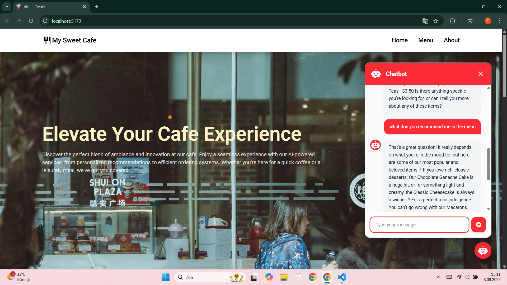
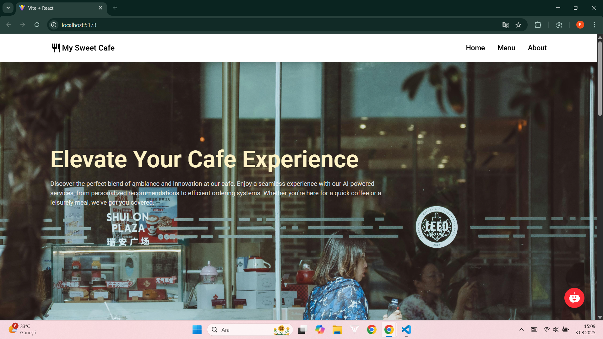
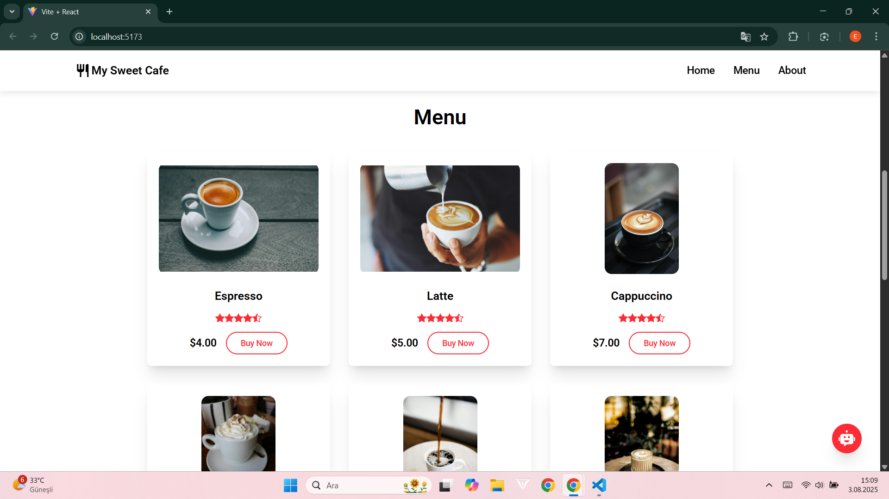
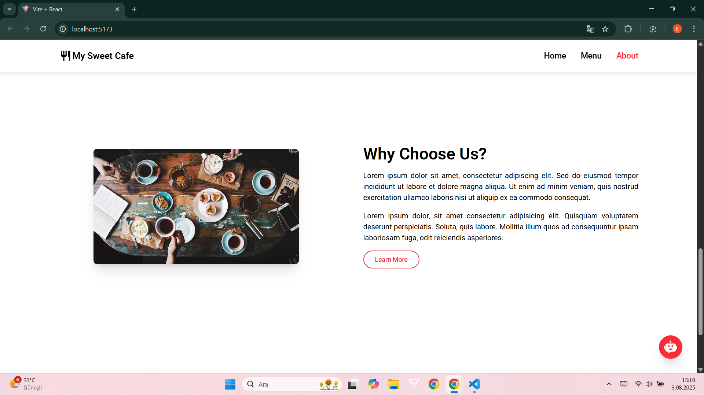
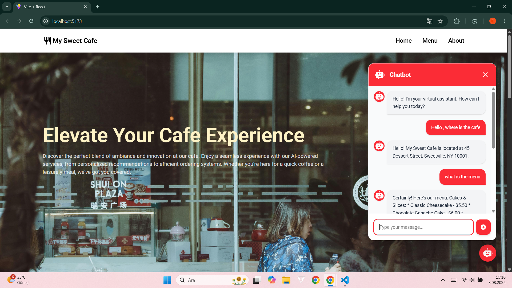

# My Sweet Cafe: Cafe Website with an AI Chatbot


A responsive single-page website for a fictional cafe, **My Sweet Cafe**, with a built-in **AI assistant** powered by the **Google Gemini API**. Visitors can browse the coffee menu, read about the cafe and ask the chatbot about prices, opening hours or recommendations.

<p align="center">
  
</p>

---

## Features

**Website**
- Full-screen hero section, coffee menu cards with prices, about section and footer with contact details
- Smooth-scrolling navigation between sections (`react-scroll`)
- Responsive layout styled with **Tailwind CSS 4**

**AI chatbot**
- Floating chat button that opens and closes a chat popup
- Answers are grounded in the cafe's details (`src/CompanyInfo.js`), which are sent to Gemini as a hidden first message
- Multi-turn conversation: the full chat history goes with each request
- "Thinking..." indicator while waiting, error messages shown in the chat, auto-scroll to the latest message

## Screenshots

<div align="center">
  
  
  
</div>

<div align="center">
  
  
</div>

## How the chatbot works

```
ChatbotPopup (state: isOpen, chatHistory)
   │
   ├── hidden message: CompanyInfo  ─┐
   ├── user / model messages        ─┼─► mapped to { role, parts: [{ text }] }
   │                                 │
   │                                 ▼
   │              POST Gemini generateContent (URL from VITE_API_URL)
   │                                 │
   └── ChatMessage ◄── candidates[0].content.parts[0].text (bold markers stripped)
```

## Project structure

```
cafe_website_chatbot/
├── src/
│   ├── App.jsx                  # Page layout: Navbar, Home, Coffees, About, Footer + chatbot
│   ├── CompanyInfo.js           # Business details the chatbot uses
│   ├── components/
│   │   ├── Navbar.jsx           # Smooth-scroll navigation
│   │   ├── Home.jsx             # Hero section
│   │   ├── Coffees.jsx          # Menu with coffee cards
│   │   ├── About.jsx
│   │   ├── Footer.jsx
│   │   └── Chatbot/             # ChatForm, ChatMessage, ChatbotIcon
│   ├── layouts/                 # Button, CoffeesCard
│   ├── pages/ChatbotPopup.jsx   # Chat window and Gemini API call
│   └── assets/                  # Images and screenshots
├── vite.config.js               # React + Tailwind CSS plugins
└── package.json
```

## Getting started

### Prerequisites

- Node.js 18+
- A Gemini API key from [Google AI Studio](https://aistudio.google.com/apikey)

### Setup

```bash
git clone https://github.com/eceakin/web_cafe_ai.git
cd web_cafe_ai/cafe_website_chatbot
npm install
cp .env.example .env
```

Put your key into `.env`:

```env
VITE_API_URL=https://generativelanguage.googleapis.com/v1/models/gemini-2.5-flash:generateContent?key=YOUR_GEMINI_API_KEY
```

`.env` is git-ignored.

### Run

```bash
npm run dev       # http://localhost:5173
npm run build     # production build in dist/
```

## Customisation

- **Cafe details**: edit `src/CompanyInfo.js` (introduction, address, hours, contact, menu). The chatbot picks up changes immediately.
- **Menu cards**: edit `src/components/Coffees.jsx`.
- **Model**: change the model name in `VITE_API_URL`.

## Security note

`VITE_` variables are bundled into the client-side code, so the API key is visible in the browser of anyone using the deployed site. Use it as-is only for local development. For a public deployment, route the Gemini request through a small backend or serverless function that keeps the key on the server.

## Tech stack

React 19 · Vite · Tailwind CSS 4 · react-scroll · react-icons · Google Gemini API

## Related

- [chatbot-geminiapi](https://github.com/eceakin/chatbot-geminiapi): the standalone version of the chatbot
